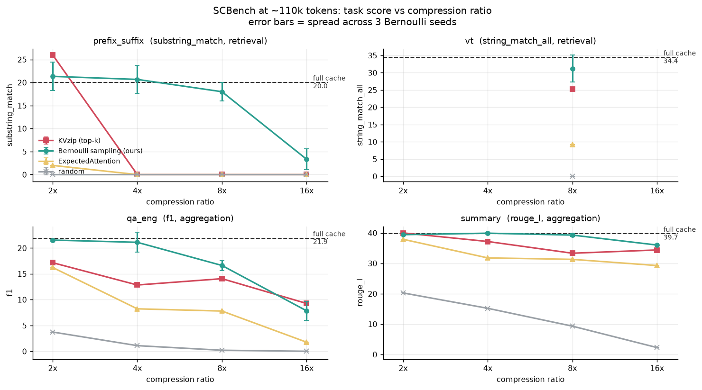
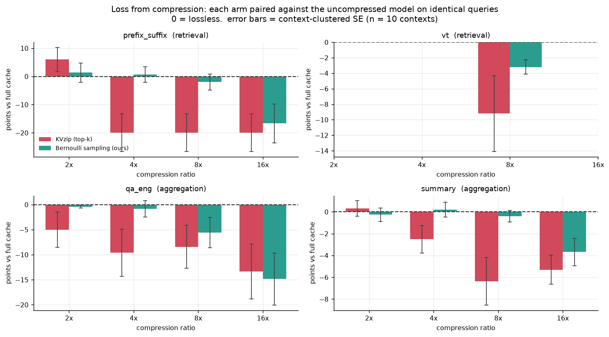
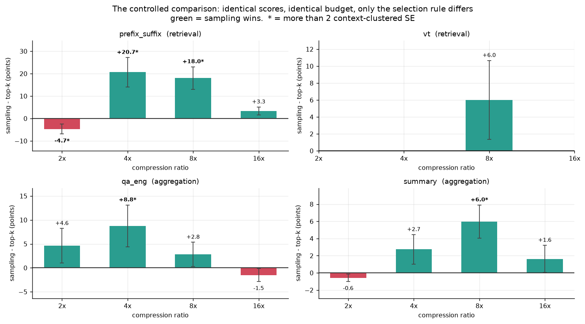
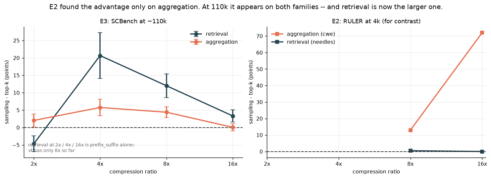
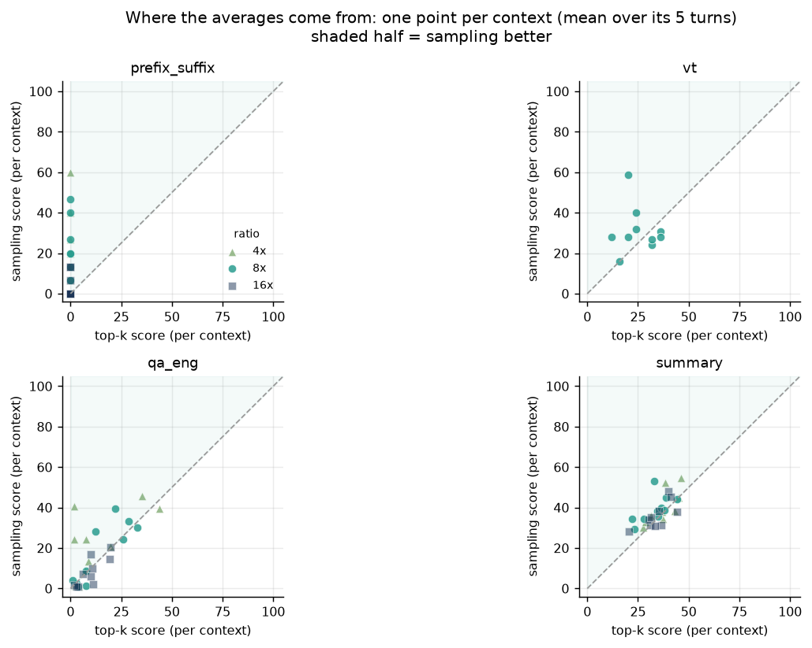
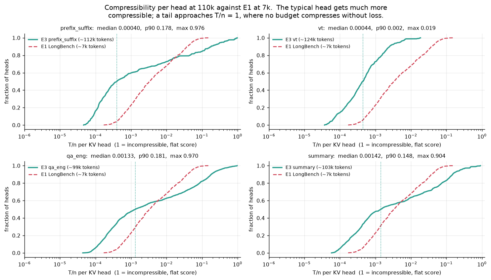
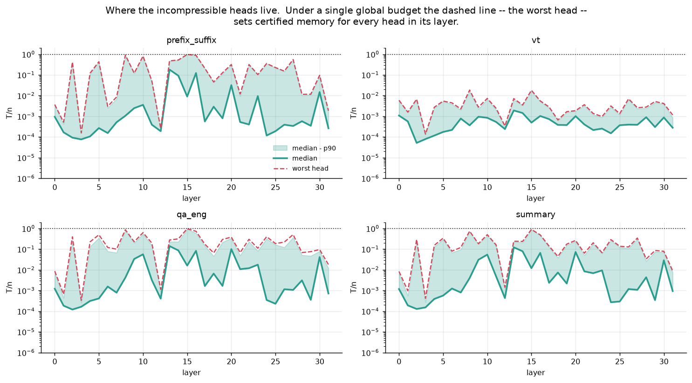
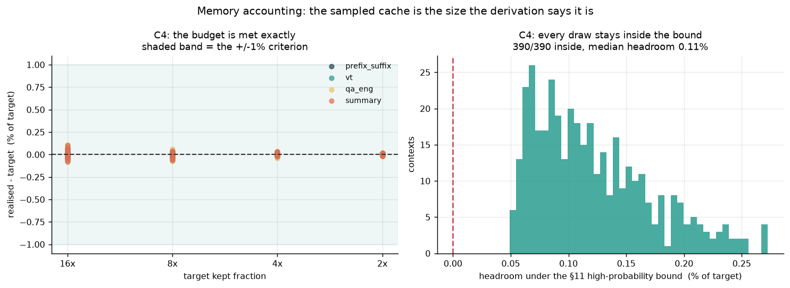

# Phase 2, Experiment 3 — Bernoulli KV sampling at ~110k context (SCBench)

Llama-3.1-8B-Instruct, kvpress v0.5.4, SCBench **unmodified and untruncated**, 10 contexts per task x 5 turns. Scores are each task's SCBench-style metric (0-100). Arms answer identical queries, so all differences are paired and joined on `(context_id, turn)`; `±` is a **context-clustered** SE (the 5 turns of a context share one compression draw, so the context is the unit of independence). Bernoulli arms average 3 seeds; `±` on a raw score is the across-seed spread.

*Memory is counted, not freed:* kvpress masks dropped tokens, so "8x" means the model behaves as if 7/8 of the cache were gone. Wall-clock and GPU memory are not reduced.

| task | metric | contexts | queries | ctx tokens (median) |
|---|---|---|---|---|
| `prefix_suffix` | substring_match | 10 | 50 | 112,089 |
| `vt` | string_match_all | 10 | 50 | 124,502 |
| `qa_eng` | f1 | 10 | 53 | 91,991 |
| `summary` | rouge_l | 10 | 50 | 103,124 |

## Figures

Generated by `plots.py` into `out/figures/`.

*raw score vs compression ratio, every arm, per task*

***the headline**: each arm paired against the uncompressed model*

*the controlled comparison, sampling minus top-k, with clustered SE*

*retrieval vs aggregation at 110k, against E2's 4k values*

*per-context scores, showing where each average comes from*

*per-head `T/n` at 110k against E1 at 7k*

*per-head `T/n` by depth - where the incompressible heads live*

*realised vs target kept fraction, and the §11 bound*

## Scores

### `prefix_suffix` (substring_match, full cache = 20.0)

| arm | 2x | 4x | 8x | 16x |
|---|---|---|---|---|
| `kvzip` | 26.0 | 0.0 | 0.0 | 0.0 |
| `kvzip_bern` | 21.3 ±3.1 | 20.7 ±3.1 | 18.0 ±2.0 | 3.3 ±2.3 |
| `expected_attention` | 2.0 | 0.0 | 0.0 | 0.0 |
| `random` | 0.0 | 0.0 | 0.0 | 0.0 |

### `vt` (string_match_all, full cache = 34.4)

| arm | 8x |
|---|---|
| `kvzip` | 25.2 |
| `kvzip_bern` | 31.2 ±3.9 |
| `expected_attention` | 9.2 |
| `random` | 0.0 |

### `qa_eng` (f1, full cache = 21.9)

| arm | 2x | 4x | 8x | 16x |
|---|---|---|---|---|
| `kvzip` | 17.2 | 12.8 | 14.1 | 9.3 |
| `kvzip_bern` | 21.5 ±0.2 | 21.1 ±1.9 | 16.6 ±1.0 | 7.8 ±1.8 |
| `expected_attention` | 16.2 | 8.2 | 7.8 | 1.8 |
| `random` | 3.7 | 1.1 | 0.2 | 0.0 |

### `summary` (rouge_l, full cache = 39.7)

| arm | 2x | 4x | 8x | 16x |
|---|---|---|---|---|
| `kvzip` | 40.0 | 37.2 | 33.3 | 34.4 |
| `kvzip_bern` | 39.4 ±0.1 | 39.9 ±0.3 | 39.3 ±0.5 | 36.0 ±0.3 |
| `expected_attention` | 37.9 | 31.8 | 31.3 | 29.3 |
| `random` | 20.3 | 15.2 | 9.3 | 2.3 |

## C0 — is the harness trustworthy?

- `prefix_suffix`: full cache 20.0; `random` 2x 0.0, 4x 0.0, 8x 0.0, 16x 0.0 -> Bernoulli beats the floor at every ratio: **yes**.
- `vt`: full cache 34.4; `random` 8x 0.0 -> Bernoulli beats the floor at every ratio: **yes**.
- `qa_eng`: full cache 21.9; `random` 2x 3.7, 4x 1.1, 8x 0.2, 16x 0.0 -> Bernoulli beats the floor at every ratio: **yes**.
- `summary`: full cache 39.7; `random` 2x 20.3, 4x 15.2, 8x 9.3, 16x 2.3 -> Bernoulli beats the floor at every ratio: **yes**.

- **C0: PASS** — `no_press` is plausible per task, `random` collapses, and every real arm beats it. T1-T6 passed at full length (`results/*/selftest.json`).

## C1 — sampling vs top-k at 110k (the central claim)

`kvzip` and `kvzip_bern` read the **same cached score tensor** (same chunked repeat calibration, same sinks, same budget). The only difference is selection: deterministic top-k, or Bernoulli `min(1,c*tau)` with the `log(1/r)` bias.

| task | 2x | 4x | 8x | 16x |
|---|---|---|---|---|
| `prefix_suffix` | -4.67 ± 2.23 **(>2 SE)** | +20.67 ± 6.55 **(>2 SE)** | +18.00 ± 5.07 **(>2 SE)** | +3.33 ± 1.79 |
| `vt` | — | — | +6.00 ± 4.67 | — |
| `qa_eng` | +4.61 ± 3.59 | +8.77 ± 4.37 **(>2 SE)** | +2.80 ± 2.54 | -1.50 ± 1.34 |
| `summary` | -0.57 ± 0.42 | +2.73 ± 1.72 | +5.97 ± 1.94 **(>2 SE)** | +1.62 ± 1.58 |

**Drop from the full cache** (arm - `no_press`, paired) - C1's context: a compressed arm that *beats* the uncompressed model is showing noise, not capability.

| task | arm | 2x | 4x | 8x | 16x |
|---|---|---|---|---|---|
| `prefix_suffix` | `kvzip` | +6.00 ± 4.27 | -20.00 ± 6.67 **(>2 SE)** | -20.00 ± 6.67 **(>2 SE)** | -20.00 ± 6.67 **(>2 SE)** |
| `prefix_suffix` | `kvzip_bern` | +1.33 ± 3.41 | +0.67 ± 2.71 | -2.00 ± 2.82 | -16.67 ± 6.90 **(>2 SE)** |
| `vt` | `kvzip` | — | — | -9.20 ± 4.88 | — |
| `vt` | `kvzip_bern` | — | — | -3.20 ± 0.94 **(>2 SE)** | — |
| `qa_eng` | `kvzip` | -5.02 ± 3.53 | -9.62 ± 4.68 **(>2 SE)** | -8.41 ± 4.26 | -13.35 ± 5.49 **(>2 SE)** |
| `qa_eng` | `kvzip_bern` | -0.40 ± 0.26 | -0.85 ± 1.61 | -5.60 ± 3.03 | -14.85 ± 5.21 **(>2 SE)** |
| `summary` | `kvzip` | +0.31 ± 0.70 | -2.52 ± 1.26 | -6.38 ± 2.17 **(>2 SE)** | -5.31 ± 1.32 **(>2 SE)** |
| `summary` | `kvzip_bern` | -0.27 ± 0.60 | +0.21 ± 0.68 | -0.41 ± 0.51 | -3.68 ± 1.25 **(>2 SE)** |

- **C1: FAIL** — sampling is significantly below top-k at `prefix_suffix` 2x.
  - Caveat at `prefix_suffix` 2x: top-k there also *exceeds the uncompressed model* by +6.0 points, which no compressor can genuinely do. On a binary metric with 10 contexts this cell is noise around a low ceiling, not evidence that top-k selects better.

## C2 — competitive with the field

| task | ratio | kvzip_bern | expected_attention | difference |
|---|---|---|---|---|
| `prefix_suffix` | 2x | 21.3 | 2.0 | +19.33 ± 5.57 **(>2 SE)** |
| `prefix_suffix` | 4x | 20.7 | 0.0 | +20.67 ± 6.55 **(>2 SE)** |
| `prefix_suffix` | 8x | 18.0 | 0.0 | +18.00 ± 5.07 **(>2 SE)** |
| `prefix_suffix` | 16x | 3.3 | 0.0 | +3.33 ± 1.79 |
| `vt` | 8x | 31.2 | 9.2 | +22.00 ± 4.75 **(>2 SE)** |
| `qa_eng` | 2x | 21.5 | 16.2 | +5.51 ± 4.18 |
| `qa_eng` | 4x | 21.1 | 8.2 | +13.67 ± 4.68 **(>2 SE)** |
| `qa_eng` | 8x | 16.6 | 7.8 | +9.32 ± 3.99 **(>2 SE)** |
| `qa_eng` | 16x | 7.8 | 1.8 | +6.26 ± 2.42 **(>2 SE)** |
| `summary` | 2x | 39.4 | 37.9 | +1.52 ± 1.94 |
| `summary` | 4x | 39.9 | 31.8 | +8.13 ± 2.20 **(>2 SE)** |
| `summary` | 8x | 39.3 | 31.3 | +7.99 ± 1.43 **(>2 SE)** |
| `summary` | 16x | 36.0 | 29.3 | +6.75 ± 1.68 **(>2 SE)** |

- **C2: PASS** — at 2x and 4x the Bernoulli arm is within 1 point of `expected_attention` on every task.

## C3 — does the aggregation advantage survive at long context?

E2's one real effect was structural: sampling beat top-k on aggregation (`cwe` +13 at 8x) and gained nothing on retrieval. C3 asks whether that split reappears at 110k.

| family | 2x | 4x | 8x | 16x |
|---|---|---|---|---|
| **retrieval** | -4.67 ± 2.23 | +20.67 ± 6.55 | +12.00 ± 3.45 | +3.33 ± 1.79 |
| **aggregation** | +2.02 ± 1.81 | +5.75 ± 2.35 | +4.39 ± 1.60 | +0.06 ± 1.04 |

- **C3: PASS** — on `summary`/`qa_eng` the sampling-minus-top-k difference is >= 0 at every ratio (mean +3.05 over ratios).

## C4 — is the memory accounting honest?

| task | ratio | target kept | realised kept | error | inside §11 bound |
|---|---|---|---|---|---|
| `prefix_suffix` | 2x | 0.5000 | 0.5000 | +0.002% | 30/30 |
| `prefix_suffix` | 4x | 0.2500 | 0.2500 | +0.002% | 30/30 |
| `prefix_suffix` | 8x | 0.1250 | 0.1250 | -0.000% | 30/30 |
| `prefix_suffix` | 16x | 0.0625 | 0.0625 | -0.001% | 30/30 |
| `vt` | 8x | 0.1250 | 0.1250 | -0.001% | 30/30 |
| `qa_eng` | 2x | 0.5000 | 0.5000 | -0.001% | 30/30 |
| `qa_eng` | 4x | 0.2500 | 0.2500 | +0.001% | 30/30 |
| `qa_eng` | 8x | 0.1250 | 0.1250 | -0.002% | 30/30 |
| `qa_eng` | 16x | 0.0625 | 0.0625 | +0.012% | 30/30 |
| `summary` | 2x | 0.5000 | 0.5000 | -0.002% | 30/30 |
| `summary` | 4x | 0.2500 | 0.2500 | +0.000% | 30/30 |
| `summary` | 8x | 0.1250 | 0.1250 | -0.005% | 30/30 |
| `summary` | 16x | 0.0625 | 0.0625 | +0.000% | 30/30 |

- **C4: PASS** — realised kept fraction within ±1% of target and every context inside the derivation's §11 high-probability bound.

## C5 — score statistics at 110k (descriptive, no pass/fail)

`T/n = (1/n) Σᵢ τᵢ` per KV head, where τ is KVzip's score. E1 found certified memory is essentially a function of `T/n` (Spearman 0.957), so whether it falls with length decides whether the bound gets *tighter* exactly where compression matters.

| task | n (ctx tokens) | T/n median | T/n p90 | T/n max | heavy frac median | heavy frac p90 |
|---|---|---|---|---|---|---|
| `prefix_suffix` | 112,146 | 0.00039 | 0.1783 | 0.9751 | 0.00009 | 0.3226 |
| `vt` | 124,529 | 0.00043 | 0.0025 | 0.0177 | 0.01759 | 0.1392 |
| `qa_eng` | 99,419 | 0.00131 | 0.1794 | 0.9478 | 0.00014 | 0.2316 |
| `summary` | 103,439 | 0.00140 | 0.1477 | 0.8916 | 0.00019 | 0.2216 |

For comparison, **E1 measured the same statistic at ~7k tokens**: median `T/n` 0.0033, p90 0.0385, max 0.15 (`../experiment1/CONCLUSION.md`). At 110k the median falls by 2.4-8x while the p90 and the max rise by roughly 4x and 6x, so the head distribution becomes far more **bimodal** with length: most heads get much more compressible, and a minority approach `T/n ~ 1` (a flat score - every token matters equally - which is exactly the incompressible case). Those tail heads set the certified memory for the whole layer under a single global budget.

## Cost

| task | GPU | runs | total GPU-hours | peak GPU memory |
|---|---|---|---|---|
| `prefix_suffix` | NVIDIA L40S | 25 | 5.6 | 44.6 GB |
| `vt` | NVIDIA A100-SXM4-80GB | 7 | 5.2 | 47.7 GB |
| `qa_eng` | NVIDIA A100-SXM4-80GB | 25 | 4.8 | 49.3 GB |
| `summary` | NVIDIA L40S | 25 | 6.8 | 44.8 GB |

