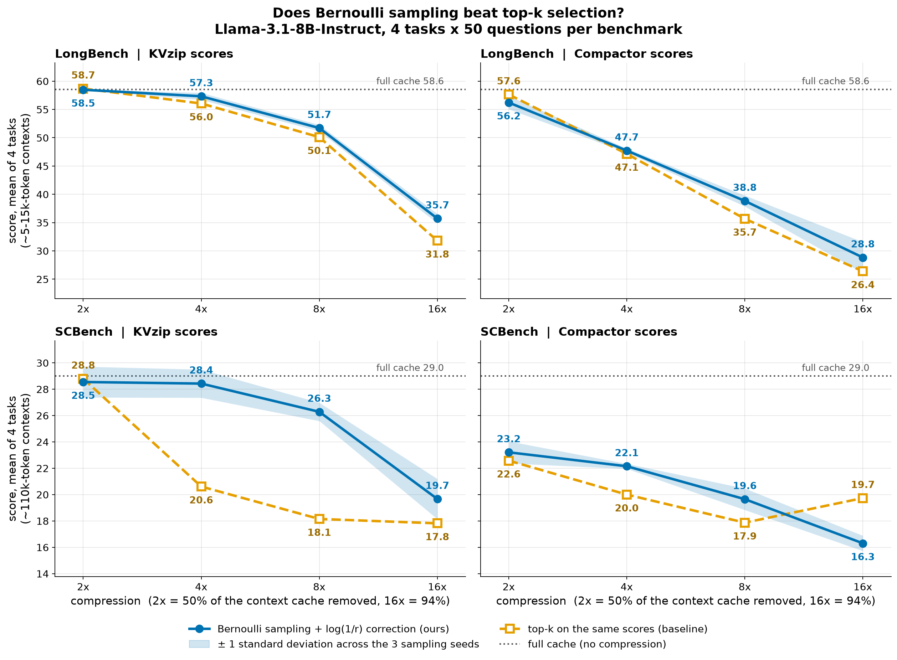
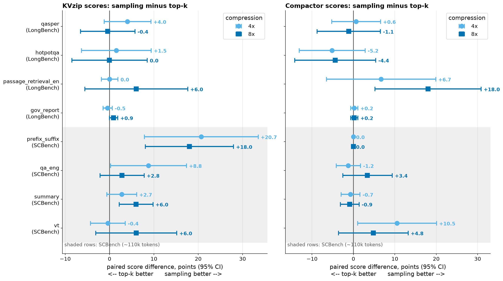
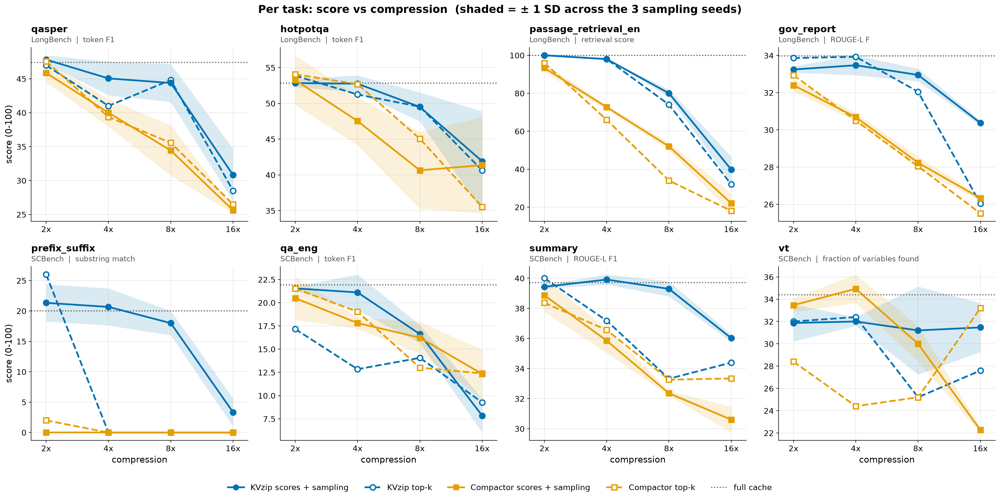
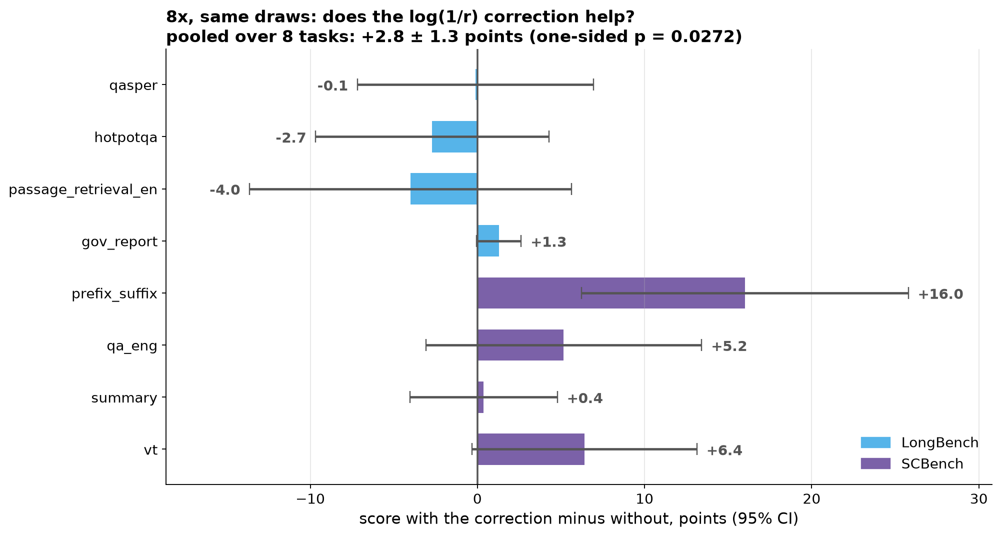

# Experiment 4: does Bernoulli sampling help both scorers?

Llama-3.1-8B-Instruct, kvpress v0.5.4. LongBench: 4 tasks x 50 questions (E8's subset). SCBench: 4 tasks x 10 untruncated contexts x 5 turns (E3's set; qa_eng has 53 questions). Scores are 0-100 per task metric. Bernoulli arms average 3 seeds per question; in the score tables, `± x` after a Bernoulli score is the standard deviation across its 3 seeds (n - 1), not an error bar. Paired differences are clustered (SCBench: context, LongBench: question); `p` is a one-sided sign-flip test of 'sampling helps', unadjusted unless marked Holm. Definitions: `DESIGN.md`, section 'Measurement breakdown'.

**Verdict:** **Pre-registered label: no consistent help.** On average sampling helps both scorers at 8x (C1 PASS, C2 PASS), but not on at least 3 of 4 tasks in each benchmark (C3 FAIL; counts of tasks with a non-negative effect: D_KV LongBench 2/4, D_KV SCBench 4/4, D_CP LongBench 2/4, D_CP SCBench 3/4).

**Completeness:** 272 runs loaded, all 272 expected runs present.

*Memory is counted, not freed:* every Bernoulli arm (and kvzip, via kvpress's head-wise masking) keeps dropped tokens in GPU memory behind a -inf bias, so "8x" means the model behaves as if 7/8 of the context cache were gone. Only plain `compactor` actually prunes. Wall-clock and memory savings are not measured here.

## Key numbers (8x, pooled over all 8 tasks)

| quantity | effect (points) | one-sided p |
|---|---|---|
| sampling vs top-k on KVzip scores (D_KV) | +4.90 ± 1.38 | 0.0005 (Holm 0.0016) |
| sampling vs top-k on Compactor scores (D_CP) | +2.49 ± 1.32 | 0.0329 (Holm 0.0658) |
| log(1/r) correction on vs off (D2, seed 1) | +2.80 ± 1.31 | 0.0264 |
| KVzip scores vs Compactor scores, both sampled (D3) | +9.76 ± 1.18 | two-sided <0.0001 |

## Setup

| benchmark | task | metric | contexts | questions | context tokens, median [min, max] | GPU (new arms) | GPU (reused E3 arms) |
|---|---|---|---|---|---|---|---|
| LongBench | `qasper` | token F1 | 50 | 50 | 4,936 [2,130, 17,646] | A40 | - |
| LongBench | `hotpotqa` | token F1 | 50 | 50 | 14,172 [3,504, 16,403] | A40 | - |
| LongBench | `passage_retrieval_en` | retrieval score | 50 | 50 | 12,276 [9,809, 14,542] | A40 | - |
| LongBench | `gov_report` | ROUGE-L F | 50 | 50 | 8,855 [2,673, 51,443] | A40 | - |
| SCBench | `prefix_suffix` | substring match | 10 | 50 | 112,159 [111,929, 112,310] | A100-SXM4-80GB | L40S |
| SCBench | `qa_eng` | token F1 | 10 | 53 | 93,175 [87,882, 130,839] | A100-SXM4-80GB | A100-SXM4-80GB |
| SCBench | `summary` | ROUGE-L F1 | 10 | 50 | 103,164 [96,646, 113,192] | A100-SXM4-80GB | L40S |
| SCBench | `vt` | fraction of variables found | 10 | 50 | 124,531 [124,523, 124,535] | A100-SXM4-80GB | A100-SXM4-80GB |

Context tokens are Llama-3.1 tokens of each compressed context (from the Bernoulli arms' memory logs). LongBench has one question per context; SCBench answers all of a context's turns from one compression.

## Figures

Generated by `plots.py` into `out/figures/`.

***The headline**, 2 x 2: rows = benchmark, columns = scorer. In each panel, blue solid = Bernoulli sampling, orange dashed = top-k on the same scores, dotted = full cache; values printed at each point. The blue band is ± 1 standard deviation across the 3 sampling seeds, not an error bar.*

*The controlled comparisons: sampling minus top-k on the same scores, per task, at 4x (light blue) and 8x (dark blue), with 95% clustered CIs. Shaded rows are SCBench.*

*Score vs compression for each task: blue = KVzip scores, orange = Compactor scores; solid = sampling (band ± 1 SD across seeds), dashed with hollow markers = top-k; dotted = full cache.*

*8x, seed 1: the same Bernoulli draws with and without the log(1/r) correction, per task, with 95% clustered CIs.*

## Benchmark averages

Unweighted mean over the benchmark's 4 tasks of each task score. Only rows where every task has the arm.

### LongBench (full cache = 58.6)

| arm | 2x | 4x | 8x | 16x |
|---|---|---|---|---|
| `kvzip` | 58.7 | 56.0 | 50.1 | 31.8 |
| `kvzip_bern` | 58.5 | 57.3 | 51.7 | 35.7 |
| `compactor` | 57.6 | 47.1 | 35.7 | 26.4 |
| `compactor_bern` | 56.2 | 47.7 | 38.8 | 28.8 |

### SCBench (full cache = 29.0)

| arm | 2x | 4x | 8x | 16x |
|---|---|---|---|---|
| `kvzip` | 28.8 | 20.6 | 18.1 | 17.8 |
| `kvzip_bern` | 28.5 | 28.4 | 26.3 | 19.7 |
| `compactor` | 22.6 | 20.0 | 17.9 | 19.7 |
| `compactor_bern` | 23.2 | 22.1 | 19.6 | 16.3 |

## Scores per task

### LongBench: `qasper` (full cache = 47.4)

| arm | 2x | 4x | 8x | 16x |
|---|---|---|---|---|
| `kvzip` | 47.0 | 41.0 | 44.8 | 28.5 |
| `kvzip_bern` | 47.8 ± 0.6 | 45.1 ± 2.5 | 44.4 ± 2.8 | 30.8 ± 3.9 |
| `compactor` | 47.6 | 39.4 | 35.6 | 26.5 |
| `compactor_bern` | 45.9 ± 1.4 | 40.0 ± 2.0 | 34.4 ± 3.7 | 25.6 ± 0.5 |
| `kvzip_bern_nobias` | - | - | 41.4 | - |

### LongBench: `hotpotqa` (full cache = 52.8)

| arm | 2x | 4x | 8x | 16x |
|---|---|---|---|---|
| `kvzip` | 53.9 | 51.2 | 49.5 | 40.6 |
| `kvzip_bern` | 52.8 ± 0.6 | 52.7 ± 1.2 | 49.5 ± 2.0 | 41.9 ± 7.0 |
| `compactor` | 54.1 | 52.7 | 45.0 | 35.5 |
| `compactor_bern` | 53.3 ± 3.5 | 47.5 ± 3.4 | 40.6 ± 5.4 | 41.4 ± 6.7 |
| `kvzip_bern_nobias` | - | - | 50.6 | - |

### LongBench: `passage_retrieval_en` (full cache = 100.0)

| arm | 2x | 4x | 8x | 16x |
|---|---|---|---|---|
| `kvzip` | 100.0 | 98.0 | 74.0 | 32.0 |
| `kvzip_bern` | 100.0 ± 0.0 | 98.0 ± 0.0 | 80.0 ± 2.0 | 39.8 ± 6.7 |
| `compactor` | 96.0 | 66.0 | 34.0 | 18.0 |
| `compactor_bern` | 93.3 ± 2.3 | 72.7 ± 1.2 | 52.0 ± 2.0 | 22.0 ± 5.3 |
| `kvzip_bern_nobias` | - | - | 86.0 | - |

### LongBench: `gov_report` (full cache = 34.0)

| arm | 2x | 4x | 8x | 16x |
|---|---|---|---|---|
| `kvzip` | 33.9 | 33.9 | 32.0 | 26.0 |
| `kvzip_bern` | 33.2 ± 0.2 | 33.5 ± 0.5 | 33.0 ± 0.3 | 30.4 ± 0.1 |
| `compactor` | 32.9 | 30.5 | 28.0 | 25.5 |
| `compactor_bern` | 32.4 ± 0.3 | 30.7 ± 0.2 | 28.2 ± 0.3 | 26.3 ± 0.1 |
| `kvzip_bern_nobias` | - | - | 31.9 | - |

### SCBench: `prefix_suffix` (full cache = 20.0)

| arm | 2x | 4x | 8x | 16x |
|---|---|---|---|---|
| `kvzip` | 26.0 | 0.0 | 0.0 | 0.0 |
| `kvzip_bern` | 21.3 ± 3.1 | 20.7 ± 3.1 | 18.0 ± 2.0 | 3.3 ± 2.3 |
| `compactor` | 2.0 | 0.0 | 0.0 | 0.0 |
| `compactor_bern` | 0.0 ± 0.0 | 0.0 ± 0.0 | 0.0 ± 0.0 | 0.0 ± 0.0 |
| `kvzip_bern_nobias` | - | - | 0.0 | - |

### SCBench: `qa_eng` (full cache = 21.9)

| arm | 2x | 4x | 8x | 16x |
|---|---|---|---|---|
| `kvzip` | 17.2 | 12.8 | 14.1 | 9.3 |
| `kvzip_bern` | 21.5 ± 0.2 | 21.1 ± 1.9 | 16.6 ± 1.0 | 7.8 ± 1.8 |
| `compactor` | 21.5 | 19.0 | 13.0 | 12.4 |
| `compactor_bern` | 20.5 ± 2.3 | 17.8 ± 0.6 | 16.2 ± 1.7 | 12.3 ± 2.6 |
| `kvzip_bern_nobias` | - | - | 10.7 | - |

### SCBench: `summary` (full cache = 39.7)

| arm | 2x | 4x | 8x | 16x |
|---|---|---|---|---|
| `kvzip` | 40.0 | 37.2 | 33.3 | 34.4 |
| `kvzip_bern` | 39.4 ± 0.1 | 39.9 ± 0.3 | 39.3 ± 0.5 | 36.0 ± 0.3 |
| `compactor` | 38.4 | 36.6 | 33.3 | 33.3 |
| `compactor_bern` | 38.9 ± 1.1 | 35.9 ± 0.8 | 32.4 ± 0.2 | 30.6 ± 0.9 |
| `kvzip_bern_nobias` | - | - | 38.4 | - |

### SCBench: `vt` (full cache = 34.4)

| arm | 2x | 4x | 8x | 16x |
|---|---|---|---|---|
| `kvzip` | 32.0 | 32.4 | 25.2 | 27.6 |
| `kvzip_bern` | 31.9 ± 1.7 | 32.0 ± 0.4 | 31.2 ± 3.9 | 31.5 ± 2.2 |
| `compactor` | 28.4 | 24.4 | 25.2 | 33.2 |
| `compactor_bern` | 33.5 ± 0.6 | 34.9 ± 1.3 | 30.0 ± 1.6 | 22.3 ± 0.2 |
| `kvzip_bern_nobias` | - | - | 29.2 | - |

## Sampling effect per task

Paired difference in points, ± clustered SE, one-sided p (unadjusted). Positive = sampling beats top-k on the same scores.

### D_KV = kvzip_bern - kvzip

| task | 2x | 4x | 8x | 16x |
|---|---|---|---|---|
| qasper | +0.83 ± 2.83 (p=0.396) | +4.04 ± 2.69 (p=0.071) | -0.43 ± 3.14 (p=0.553) | +2.31 ± 3.76 (p=0.276) |
| hotpotqa | -1.02 ± 3.98 (p=0.619) | +1.51 ± 4.02 (p=0.362) | -0.03 ± 4.34 (p=0.503) | +1.27 ± 4.25 (p=0.385) |
| passage_retrieval_en | +0.00 ± 0.00 (p=1.000) | +0.00 ± 0.95 (p=0.749) | +6.00 ± 5.92 (p=0.187) | +7.78 ± 6.48 (p=0.132) |
| gov_report | -0.61 ± 0.43 (p=0.917) | -0.46 ± 0.53 (p=0.805) | +0.90 ± 0.48 (p=0.031) | +4.33 ± 0.62 (p=0.000) |
| prefix_suffix | -4.67 ± 2.23 (p=1.000) | +20.67 ± 6.55 (p=0.008) | +18.00 ± 5.07 (p=0.004) | +3.33 ± 1.79 (p=0.125) |
| qa_eng | +4.61 ± 3.59 (p=0.148) | +8.77 ± 4.37 (p=0.034) | +2.80 ± 2.54 (p=0.178) | -1.50 ± 1.34 (p=0.854) |
| summary | -0.57 ± 0.42 (p=0.902) | +2.73 ± 1.72 (p=0.073) | +5.97 ± 1.94 (p=0.001) | +1.62 ± 1.58 (p=0.160) |
| vt | -0.13 ± 1.22 (p=0.625) | -0.40 ± 2.01 (p=0.594) | +6.00 ± 4.67 (p=0.125) | +3.87 ± 4.35 (p=0.220) |

### D_CP = compactor_bern - compactor

| task | 2x | 4x | 8x | 16x |
|---|---|---|---|---|
| qasper | -1.70 ± 3.09 (p=0.697) | +0.64 ± 3.00 (p=0.415) | -1.14 ± 3.90 (p=0.613) | -0.88 ± 3.44 (p=0.600) |
| hotpotqa | -0.80 ± 3.13 (p=0.596) | -5.16 ± 4.07 (p=0.891) | -4.41 ± 4.99 (p=0.807) | +5.83 ± 3.68 (p=0.060) |
| passage_retrieval_en | -2.67 ± 3.14 (p=0.829) | +6.67 ± 6.73 (p=0.188) | +18.00 ± 6.54 (p=0.006) | +4.00 ± 5.69 (p=0.281) |
| gov_report | -0.54 ± 0.42 (p=0.896) | +0.18 ± 0.44 (p=0.343) | +0.19 ± 0.44 (p=0.333) | +0.81 ± 0.50 (p=0.055) |
| prefix_suffix | -2.00 ± 2.00 (p=1.000) | +0.00 ± 0.00 (p=1.000) | +0.00 ± 0.00 (p=1.000) | +0.00 ± 0.00 (p=1.000) |
| qa_eng | -1.01 ± 2.02 (p=0.644) | -1.25 ± 1.50 (p=0.789) | +3.38 ± 3.05 (p=0.140) | -0.16 ± 2.42 (p=0.534) |
| summary | +0.50 ± 1.10 (p=0.420) | -0.71 ± 1.16 (p=0.727) | -0.90 ± 1.16 (p=0.770) | -2.74 ± 1.18 (p=0.980) |
| vt | +5.07 ± 4.80 (p=0.172) | +10.53 ± 4.86 (p=0.025) | +4.80 ± 4.29 (p=0.152) | -10.93 ± 3.78 (p=0.994) |

## Criteria (pre-registered)

- **C1**, D_KV at 8x pooled over 8 tasks: +4.90 ± 1.38, p = 0.0005 -> **PASS**
- **C2**, D_CP at 8x pooled over 8 tasks: +2.49 ± 1.32, p = 0.0329 -> **PASS**
- **C3**, 8x, >= 0 on at least 3 of 4 tasks per benchmark: D_KV LongBench 2/4; D_KV SCBench 4/4; D_CP LongBench 2/4; D_CP SCBench 3/4 -> **FAIL**
- **C4**, pooled tests with Holm over {4x, 8x} x {KV, CP}:
  - 8x D_KV: +4.90 ± 1.38, p = 0.0005, Holm 0.0016 (8 tasks)
  - 8x D_CP: +2.49 ± 1.32, p = 0.0329, Holm 0.0658 (8 tasks)
  - 4x D_KV: +4.61 ± 1.21, p = 0.0003, Holm 0.0012 (8 tasks)
  - 4x D_CP: +1.36 ± 1.24, p = 0.1492, Holm 0.1492 (8 tasks)
  - 2x D_KV (no harm if the 95% CI stays above -2): -0.19, CI [-1.81, +1.42] (8 tasks) -> PASS
  - 2x D_CP (no harm if the 95% CI stays above -2): -0.39, CI [-2.32, +1.53] (8 tasks) -> FAIL
  - 16x D_KV (reported only): +2.88 ± 1.26, p = 0.0111 (8 tasks)
  - 16x D_CP (reported only): -0.51 ± 1.11, p = 0.6657 (8 tasks)

**Verdict:** **Pre-registered label: no consistent help.** On average sampling helps both scorers at 8x (C1 PASS, C2 PASS), but not on at least 3 of 4 tasks in each benchmark (C3 FAIL; counts of tasks with a non-negative effect: D_KV LongBench 2/4, D_KV SCBench 4/4, D_CP LongBench 2/4, D_CP SCBench 3/4).

## Descriptive (no pass/fail)

**D1, by benchmark** (pooled paired effect, ± SE, one-sided p):

| effect | ratio | LongBench | SCBench |
|---|---|---|---|
| D_KV | 2x | -0.20 ± 1.23 (p=0.5619, 4 tasks) | -0.19 ± 1.11 (p=0.5581, 4 tasks) |
| D_KV | 4x | +1.27 ± 1.24 (p=0.1556, 4 tasks) | +7.94 ± 2.08 (p=0.0003, 4 tasks) |
| D_KV | 8x | +1.61 ± 2.00 (p=0.2118, 4 tasks) | +8.19 ± 1.90 (p=<0.0001, 4 tasks) |
| D_KV | 16x | +3.92 ± 2.16 (p=0.0355, 4 tasks) | +1.83 ± 1.29 (p=0.0816, 4 tasks) |
| D_CP | 2x | -1.43 ± 1.35 (p=0.8522, 4 tasks) | +0.64 ± 1.42 (p=0.3386, 4 tasks) |
| D_CP | 4x | +0.58 ± 2.11 (p=0.3917, 4 tasks) | +2.14 ± 1.30 (p=0.0820, 4 tasks) |
| D_CP | 8x | +3.16 ± 2.28 (p=0.0905, 4 tasks) | +1.82 ± 1.35 (p=0.0965, 4 tasks) |
| D_CP | 16x | +2.44 ± 1.90 (p=0.1012, 4 tasks) | -3.46 ± 1.16 (p=0.9957, 4 tasks) |

**D2, is the log(1/r) correction what helps?** kvzip_bern_s1 - kvzip_bern_nobias_s1 at 8x (same draws), pooled over 8 tasks: +2.80 ± 1.31, one-sided p = 0.0271.

| task | with - without correction |
|---|---|
| qasper | -0.12 ± 3.60 (p=0.514) |
| hotpotqa | -2.70 ± 3.56 (p=0.798) |
| passage_retrieval_en | -4.00 ± 4.92 (p=0.891) |
| gov_report | +1.28 ± 0.68 (p=0.032) |
| prefix_suffix | +16.00 ± 4.99 (p=0.016) |
| qa_eng | +5.16 ± 4.21 (p=0.129) |
| summary | +0.37 ± 2.25 (p=0.436) |
| vt | +6.40 ± 3.44 (p=0.062) |

**D3, which scorer is better under sampling?** kvzip_bern - compactor_bern, pooled over tasks (two-sided p):

- 2x: +3.81 ± 1.04, p ~ 0.0010 (8 tasks)
- 4x: +7.96 ± 1.13, p ~ <0.0001 (8 tasks)
- 8x: +9.76 ± 1.18, p ~ <0.0001 (8 tasks)
- 16x: +5.11 ± 1.17, p ~ <0.0001 (8 tasks)

**D4, each arm against the full cache** (benchmark mean of task score minus no_press, points):

| benchmark | arm | 2x | 4x | 8x | 16x |
|---|---|---|---|---|---|
| LongBench | `kvzip` | +0.1 | -2.5 | -8.5 | -26.8 |
| LongBench | `kvzip_bern` | -0.1 | -1.2 | -6.8 | -22.8 |
| LongBench | `compactor` | -0.9 | -11.4 | -22.9 | -32.2 |
| LongBench | `compactor_bern` | -2.3 | -10.8 | -19.7 | -29.7 |
| SCBench | `kvzip` | -0.2 | -8.4 | -10.9 | -11.2 |
| SCBench | `kvzip_bern` | -0.5 | -0.6 | -2.7 | -9.3 |
| SCBench | `compactor` | -6.4 | -9.0 | -11.1 | -9.3 |
| SCBench | `compactor_bern` | -5.8 | -6.9 | -9.4 | -12.7 |

## Memory accounting

Realised kept fraction of the context cache, per compressed context (mean [min, max] over all contexts and seeds). Top-k arms keep exactly the target by construction. KVzip-Bernoulli splits the budget globally (the total is on target, per head it varies); Compactor-Bernoulli per head.

| benchmark | arm | 2x (0.5) | 4x (0.25) | 8x (0.125) | 16x (0.0625) |
|---|---|---|---|---|---|
| LongBench | `kvzip_bern` | 0.5000 [0.499, 0.501] | 0.2500 [0.249, 0.251] | 0.1250 [0.124, 0.126] | 0.0625 [0.062, 0.063] |
| LongBench | `compactor_bern` | 0.5000 [0.499, 0.501] | 0.2499 [0.249, 0.251] | 0.1250 [0.124, 0.126] | 0.0624 [0.062, 0.063] |
| LongBench | `kvzip_bern_nobias` | - | - | 0.1250 [0.125, 0.126] | - |
| SCBench | `kvzip_bern` | 0.5000 [0.500, 0.500] | 0.2500 [0.250, 0.250] | 0.1250 [0.125, 0.125] | 0.0625 [0.062, 0.063] |
| SCBench | `compactor_bern` | 0.5000 [0.500, 0.500] | 0.2500 [0.250, 0.250] | 0.1250 [0.125, 0.125] | 0.0625 [0.062, 0.063] |
| SCBench | `kvzip_bern_nobias` | - | - | 0.1250 [0.125, 0.125] | - |

## Cost

Wall-clock seconds per run (one run = all questions of a task at one ratio) and peak GPU memory, mean over the run's ratios and seeds. Reused E3 runs are included for SCBench.

| task | GPU | no_press | kvzip | kvzip_bern | compactor | compactor_bern | kvzip_bern_nobias |
|---|---|---|---|---|---|---|---|
| qasper | A40 | 85 s / 20 GB | 150 s / 20 GB | 128 s / 20 GB | 84 s / 20 GB | 123 s / 21 GB | 131 s / 20 GB |
| hotpotqa | A40 | 143 s / 20 GB | 284 s / 20 GB | 189 s / 20 GB | 163 s / 20 GB | 190 s / 21 GB | 189 s / 20 GB |
| passage_retrieval_en | A40 | 133 s / 20 GB | 262 s / 20 GB | 176 s / 20 GB | 153 s / 19 GB | 179 s / 20 GB | 176 s / 20 GB |
| gov_report | A40 | 1102 s / 29 GB | 1450 s / 29 GB | 1976 s / 29 GB | 905 s / 27 GB | 2031 s / 30 GB | 1765 s / 29 GB |
| prefix_suffix | A100/L40S | 500 s / 44 GB | 944 s / 44 GB | 1006 s / 44 GB | 352 s / 40 GB | 1092 s / 48 GB | 902 s / 44 GB |
| qa_eng | A100 | 332 s / 49 GB | 898 s / 49 GB | 843 s / 49 GB | 309 s / 44 GB | 869 s / 53 GB | 911 s / 49 GB |
| summary | A100/L40S | 540 s / 44 GB | 1015 s / 44 GB | 1263 s / 44 GB | 317 s / 40 GB | 1245 s / 48 GB | 1156 s / 44 GB |
| vt | A100 | 490 s / 47 GB | 2883 s / 47 GB | 1810 s / 47 GB | 483 s / 43 GB | 1457 s / 51 GB | 1927 s / 47 GB |

Total GPU time in runs: **40.0 h new** (E4) + 23.3 h reused from E3 (excludes model loading and self-tests, a few minutes per job). Bernoulli runs are slower than top-k because the SDPA bias path builds a full bias mask at every decoding step.

## C0: harness checks

- **Completeness:** all 272 expected runs present.
- **Kept fraction** (200 Bernoulli runs): all within 1% of target.
- **GPU types:** as planned (LongBench A40; new SCBench arms A100; reused E3 arms on E3's GPUs).
- **Compactor Cholesky fallback** (layer calls rescued, summed over runs): vt 160.
- **Self-tests** (last job per group): longbench/selftest: pass; longbench/selftest_compactor: pass; scbench/selftest: pass; scbench/selftest_compactor: pass; smoke/selftest: pass; smoke/selftest_compactor: pass; smoke_vt/selftest: pass; smoke_vt/selftest_compactor: pass
- **Repetitive answers**: share of answers containing a 3-word phrase 3+ times, all ratios pooled. Long summaries repeat phrases naturally, so compare each arm with no_press on the same task:

| task | no_press | kvzip | kvzip_bern | compactor | compactor_bern |
|---|---|---|---|---|---|
| qasper | 0% | 0% | 1% | 2% | 3% |
| hotpotqa | 0% | 0% | 0% | 0% | 0% |
| passage_retrieval_en | 0% | 0% | 0% | 0% | 0% |
| gov_report | 92% | 82% | 88% | 89% | 93% |
| prefix_suffix | 0% | 0% | 0% | 0% | 0% |
| qa_eng | 0% | 1% | 1% | 0% | 0% |
| summary | 2% | 2% | 1% | 1% | 2% |
| vt | 34% | 60% | 34% | 82% | 35% |

**LongBench reproduction against E8** (same 50 samples, same GPU type; identical answers):

- qasper no_press full: 100% identical, score 47.42 vs E8 47.42
- qasper kvzip 2x: 100% identical, score 46.99 vs E8 46.99
- qasper kvzip 4x: 98% identical, score 41.01 vs E8 41.73
- qasper kvzip 8x: 98% identical, score 44.82 vs E8 44.63
- hotpotqa no_press full: 100% identical, score 52.84 vs E8 52.84
- hotpotqa kvzip 2x: 100% identical, score 53.86 vs E8 53.86
- hotpotqa kvzip 4x: 100% identical, score 51.24 vs E8 51.24
- hotpotqa kvzip 8x: 100% identical, score 49.53 vs E8 49.53
- passage_retrieval_en no_press full: 100% identical, score 100.00 vs E8 100.00
- passage_retrieval_en kvzip 2x: 100% identical, score 100.00 vs E8 100.00
- passage_retrieval_en kvzip 4x: 100% identical, score 98.00 vs E8 98.00
- passage_retrieval_en kvzip 8x: 100% identical, score 74.00 vs E8 74.00

**vt reproduction inside E3** (8x arms run twice, hours apart, by jobs 311762 and 312032: `S1n10`, used here, against `S1`):

- expected_attention 0.88: 100% identical
- kvzip 0.88: 100% identical
- kvzip_bern_s1 0.88: 100% identical
- kvzip_bern_s2 0.88: 100% identical
- kvzip_bern_s3 0.88: 100% identical
- no_press 0.00: 100% identical
- random 0.88: 100% identical
